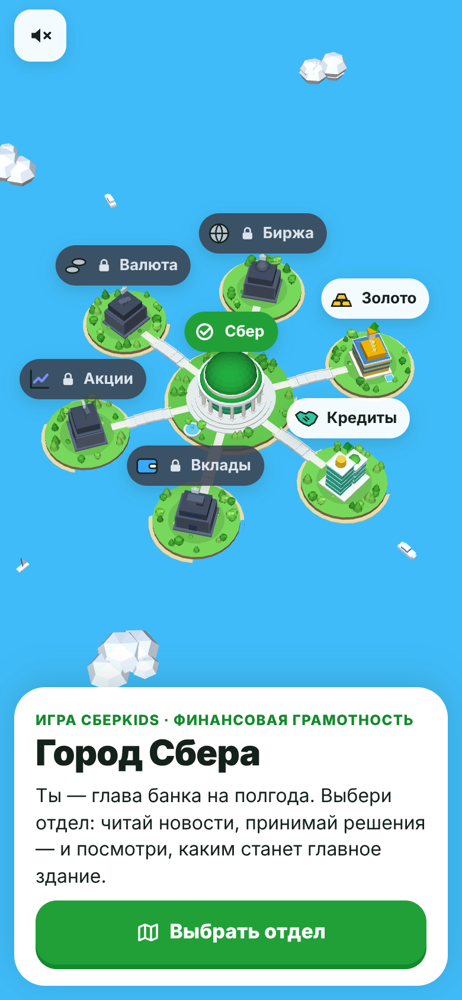
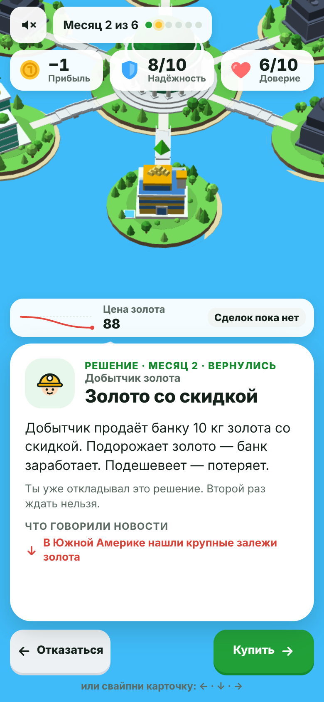
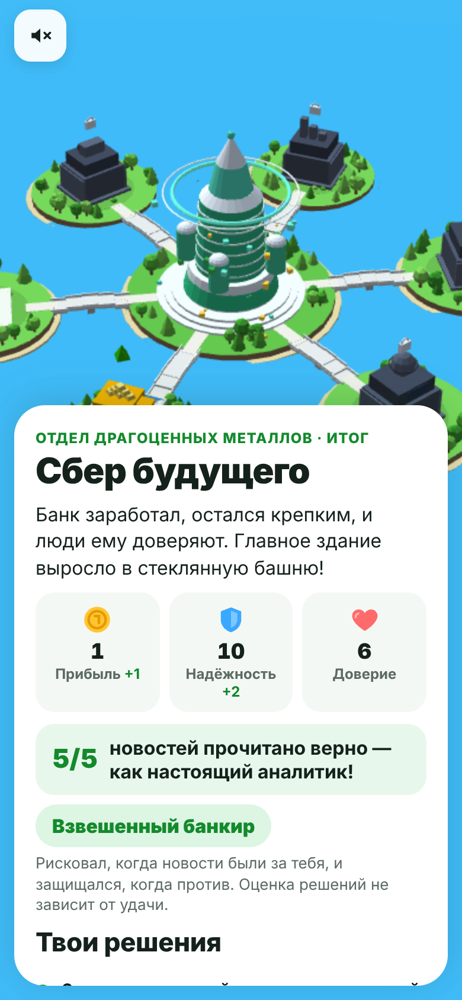

# Город Сбера

Игра для трека B «Игры», HSE × Sber Mobile Hack 2026. HTML5-страница для WebView: 3D-город на чистом WebGL, в центре главное здание Сбера, вокруг острова-отделы банка.

| Город | Решение | Итог |
|---|---|---|
|  |  |  |

**Идея.** Ребёнок выбирает отдел и полгода руководит им. Каждый месяц: новость, прогноз «что будет с ценой», решение свайпом. В конце главное здание превращается в «Сбер будущего», остаётся «Крепким Сбером» или уходит «на ремонт» — смотря насколько разумными были решения.

**Чему учит.** По новости определять, подорожает актив или подешевеет, и понимать, когда рисковать, а когда страховаться.

**Аудитория:** 10–13 лет, возрастная категория 6+. Одна партия — около 4 минут.

## Запуск

```bash
cd game
python3 -m http.server 8080
```

Открыть `http://localhost:8080`. В песочнице: `http://<IP компьютера>:8080`. Сборка не нужна.

Онлайн-версия: при каждом пуше в `main` папка `game/` публикуется на GitHub Pages (`.github/workflows/pages.yml`, включается один раз в Settings → Pages → Source: GitHub Actions). Ссылку можно открыть с телефона или вставить в песочницу.

## Как играть

1. Покрутить город пальцем, нажать на отдел. Доступны «Золото» и «Кредиты», остальные отделы закрыты.
2. Каждый месяц — новость: свайпом предсказать, куда она двинет цену (вправо — вверх, влево — вниз, вниз — «не повлияет»). Сразу виден разбор «почему».
3. Затем решение: вправо — «да», влево — «нет», вниз — «подождать» (можно один раз, ожидание стоит денег или доверия).
4. Сделка выигрывает, если рынок пошёл в её сторону. Крупная выигрывает и теряет вдвое больше. Страховка или залог снимают убыток за фиксированную плату.
4a. На каждой карточке есть кнопка «Подсказка» (лампочка): для новости — наводящий вопрос, для решения — «новости» и «сделка» рядом со значком «совпало / не совпало». Текста минимум: разбор новости — одна строка со стрелками, подробности раскрываются по нажатию.
5. Итог полугода: здание перестраивается, затем разбор решений, стиль («Взвешенный», «Азартный», «Осторожный банкир») и счёт «новостей угадано X из Y».

Три шкалы: **Деньги** банка (старт — 10 монет, задаётся в `config.json`; в итоге показывается прибыль: сколько заработал или потерял), **Надёжность** (щиты), **Доверие** (сердца). Потеря — это щиты, а не деньги. Решения оцениваются по тому, что ребёнок знал в момент выбора, а не по тому, как выпал случай: сделка по новостям считается хорошей даже при неудаче, сделка против новостей без страховки — ошибкой даже при везении.

## Случайность

Лотерей, ставок и платных попыток нет. Случайны только новости, по описанной модели:

- в начале партии тренд `up` или `down` (50/50);
- новости выбираются без повторов с весом `weight[тренд]`;
- новость двигает цену на `points × 4 %` и даёт каждой открытой сделке `±points` (у крупной ×2);
- в конце — итоговое движение по тренду на 3 очка;
- «Сбер будущего» требует взвешенных решений и хотя бы половины верно прочитанных новостей — случайным тыканием его не получить;
- убыток по сделке не больше `maxShields` щитов, если нет страховки.

Баланс проверяется командой `node tools/sim.js` (4000 партий на бота): игрок, читающий новости, получает «Сбер будущего» в 69–83 % партий, игрок, берущий всё без страховки, в 70–90 % оставляет здание «на ремонте».

## Ограничения трека

| Требование | Как выполнено |
|---|---|
| Чистый HTML/CSS/JS, без библиотек, CDN, шрифтов и аналитики | Всё в репозитории, внешних запросов нет (проверяет `tools/build.js`) |
| Вес ≤ 5 МБ | ≈ 240 КБ: графика строится кодом |
| Первый экран ≤ 3 с, 60 fps | Нет картинок и шрифтов, около 26 тыс. треугольников, разрешение снижается автоматически |
| Сессия 3–5 минут | 11 карточек, около 4 минут |
| Без сохранения состояния | Нет `localStorage`, cookies, бэкенда и авторизации |
| Звук | Выключен по умолчанию, есть переключатель |
| Портрет и горизонталь, экраны 360–430 px | Обе ориентации; на широком окне — вертикальная колонка |
| Контракт с приложением | Только `CLOSE_EVENT`, `FINISH_EVENT`, `COMPLETED_EVENT`, `VIBRATION_EVENT`, `SHARING_EVENT` |
| Без WebGL | Список отделов вместо 3D, игра проходится целиком |

События: `VIBRATION_EVENT` — свайпы и тапы, `FINISH_EVENT` — конец партии, `COMPLETED_EVENT` — один раз за открытие, `SHARING_EVENT` — «Поделиться» (`{ text, image }`, картинка рисуется на устройстве), `CLOSE_EVENT` поддерживается контрактом, но игра его не шлёт: закрытие — на стороне песочницы приложения (своей кнопки выхода в игре нет).

## Контент

Все тексты, новости, вероятности, решения и названия состояний здания лежат в JSON. Если JSON не загрузился или битый, игра берёт встроенную копию.

```
game/
  index.html, style.css     разметка и стили
  engine.js                 логика: колоды, сделки, итог, оценка решений
  city3d.js                 3D-город на WebGL 1, геометрия строится кодом
  ui.js                     экраны, свайпы, HUD, события приложения
  audio.js                  звуки синтезом WebAudio
  content/                  config.json, metals.json, credit.json, fallback.js
tools/
  cards.json                новости и решения по отделам
  card-meta.json            заголовок, «кто просит» и иконка каждой карточки решения
  event-meta.json           подсказка-вопрос и короткое «что → итог» для каждой новости
  import-cards.js           cards.json -> колоды отделов
  build.js                  встроенная копия контента + проверка веса и изоляции
  sim.js                    симуляция баланса
docs/pitch.md               сценарий защиты
```

Чтобы поменять карточки: правим `tools/cards.json`, затем

```bash
node tools/import-cards.js
node tools/build.js
node tools/sim.js
```

Новый отдел — это JSON-колода и запись в `config.json`.

### Формат карточки

В `cards.json` `options` — массив из трёх вариантов (1-й — свайп вправо, 2-й — влево, 3-й — вниз). Поля варианта: `coins`, `shields`, `hearts` — мгновенный эффект, `position` — сделка (`dir`, `size`, `maxShields`), `retry` — «подождать», `insure` — страховка.

```json
{ "id": "m02_jeweler_order", "dept": "metals", "type": "choice", "text": "…", "explain": "…", "weight": 3,
  "options": [
    { "label": "Взять заказ", "hearts": 1, "position": { "id": "gold_jeweler", "dir": "down", "size": "small", "maxShields": 3 } },
    { "label": "Отказать", "hearts": -1 },
    { "label": "Подумать ещё", "coins": -1, "hearts": -1, "retry": true } ] }
```

## Что дальше

- Остальные отделы (вклады, валюта, акции, биржа): только JSON-колоды, город уже готов.
- Озвучка карточек для младших.
- Связка с разделом «Контент» приложения.
